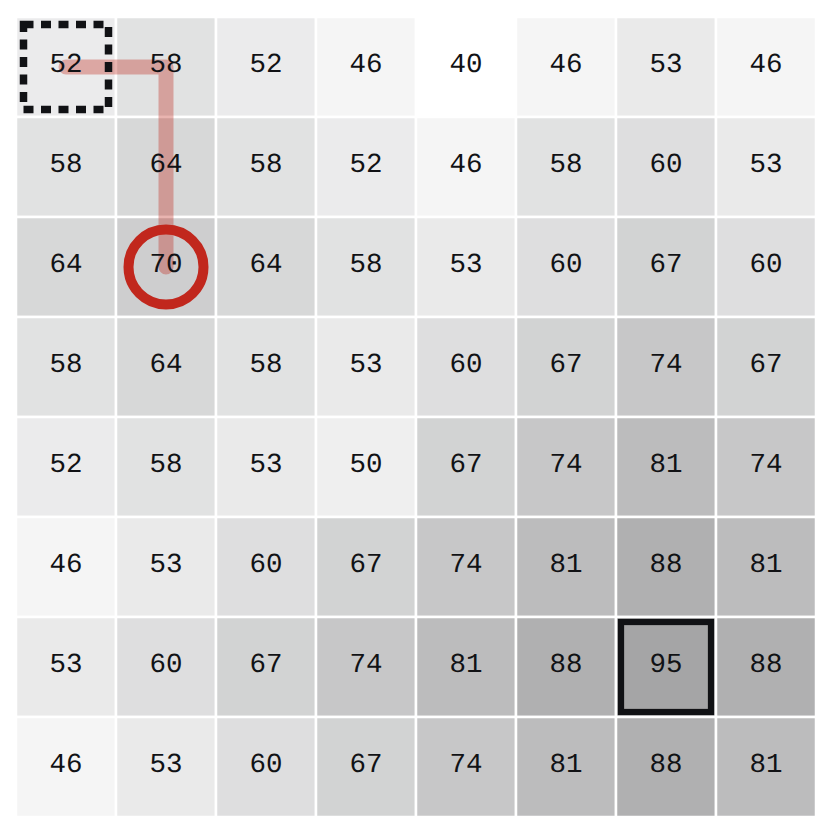
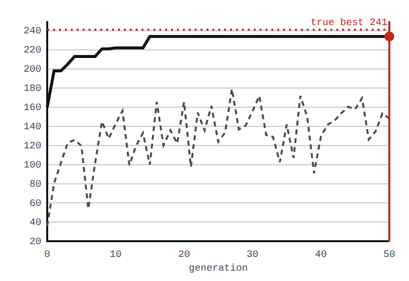
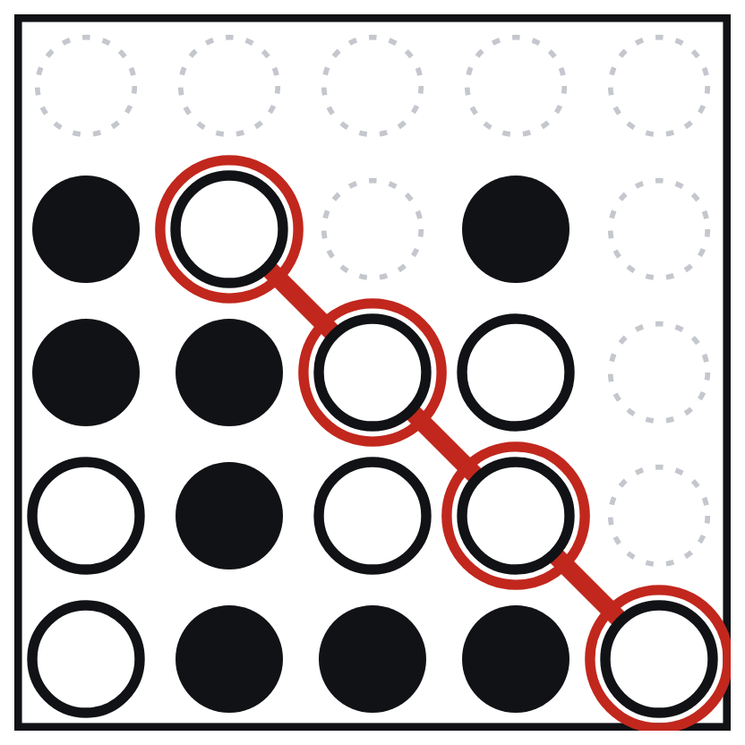

# Thornwood Rescue: Debrief

*Evidence: the Owl Cipher from `python thornwood.py`, plus the extra runs in `extras/debrief_runs.py`. Every number below is computed by that code.*

## 1. Kaito: Why did I get stuck on the first hill?

**Where it stopped:** (2,1) with value **70**, after 3 steps (`HC_FINAL`, `HC_VALUE`, `HC_STEPS`). The climb went (0,0)=52 → (0,1)=58 → (1,1)=64 → (2,1)=70. At (0,0) the right and down neighbours tie at 58, and the up, right, down, left rule takes right.

| around (2,1) | col 0 | col 1 | col 2 |
|---|---|---|---|
| row 1 | 58 | 64 | 58 |
| row 2 | 64 | **70** | 64 |
| row 3 | 58 | 64 | 58 |

**Its neighbours:** up (1,1)=64, right (2,2)=64, down (3,1)=64, left (2,0)=64. None is strictly higher than 70, so the stopping rule fires.

**Why this is a local maximum.** Hill climbing only compares a cell with its four neighbours, so any cell that beats all four looks like the top. (2,1) is one of only two such peaks on the map; the other is the real summit (6,6)=95. The best route between them still steps on a 53, a drop of 17, and steepest ascent never goes down. Restarting is the cure: the climbs from (4,0), (7,0) and (0,4) end on 70, 95 and 95 after 3, 7 and 8 steps, so the best of the four is 95 from (7,0), 21 steps in total (`RR_BEST_VALUE`, `RR_BEST_START`, `RR_TOTAL_STEPS`).

## 2. Gennai: Why did only some of the 20 fate scrolls reach the summit?

- **Result of the 20 seeded runs** (T0 = 20, cooling 0.97): **8 of 20** end on 95 (`SA_SUCCESS_1_TO_20`). The other 12 all freeze on the same false summit, (2,1)=70, the one that trapped Kaito.
- **How heat and cooling act.** A downhill step Δ < 0 is accepted with chance exp(Δ/T), and T becomes 0.97·T every iteration, so T = T0·0.97^n. Leaving the false summit means a drop of 17 (Q1), so the table gives the chance of accepting that step as the run cools.

| Iteration n | T (T0=20) | chance of −17 | T (T0=40) | chance of −17 |
|---|---|---|---|---|
| 0 | 20.00 | 0.427 | 40.00 | 0.654 |
| 25 | 9.34 | 0.162 | 18.68 | 0.402 |
| 50 | 4.36 | 0.020 | 8.72 | 0.142 |
| 100 | 0.95 | 0.000 | 1.90 | 0.000 |
| 150 | 0.21 | 0.000 | 0.41 | 0.000 |
| 199 | 0.05 | 0.000 | 0.09 | 0.000 |

| successes of 20 | rate 0.95 | rate 0.97 | rate 0.99 |
|---|---|---|---|
| T0 = 10 | 1 | 3 | 11 |
| T0 = 20 | 3 | 8 | 10 |
| T0 = 40 | 8 | 12 | 7 |
| T0 = 80 | 11 | 12 | 2 |

- Early on the walker is bold; once T < 1 (after iteration 98 for T0=20) it is greedy. Accepted downhill moves per quarter of the run, summed over the 20 seeds: 269, 61, 0, 0 (T0=20) and 336, 169, 6, 0 (T0=40). Once the chance of crossing falls below 1% (after iteration 55 for T0=20, 78 for T0=40) a run still on the 70-hill is frozen there.
- **Cooling rate** works the same way (right table). With T0 = 20, fast cooling shuts the window early (3 of 20 at 0.95) and slow cooling keeps it open (10 of 20 at 0.99). More heat is not always better: T0 = 80 with 0.99 gives only 2 of 20, because T is still 10.7 after 200 iterations and the walker is still wandering when the run stops. A good run is hot enough to cross the dip early, then cold enough to settle on the peak.
- **Re-run with T0 = 40:** **12 of 20** reach 95 (was 8). The 8 failures again all sit on (2,1)=70. The crossing window stays open for 78 iterations instead of 55, so more runs cross before freezing and still have about 122 iterations to climb and settle.

## 3. Rin: Why did the seeds stop at 234 when 241 was possible?

| Tool | Load | Vol | Use | GA | Opt |
|---|---|---|---|---|---|
| 0 Kunai set | 18 | 9 | 36 | 1 | 1 |
| 1 Wire spool | 11 | 8 | 9 | 0 | 0 |
| **2 Smoke bombs** | **12** | **5** | **10** | **0** | **1** |
| 3 Paper bombs | 9 | 3 | 32 | 1 | 1 |
| 4 Energy pills | 5 | 7 | 31 | 1 | 1 |
| **5 Flash tags** | **5** | **6** | **8** | **1** | **0** |
| 6 Messenger scroll | 11 | 3 | 33 | 1 | 1 |
| 7 Giant shuriken | 20 | 6 | 27 | 0 | 0 |
| 8 Spare rations | 13 | 6 | 5 | 0 | 0 |
| 9 Wind shuriken | 11 | 2 | 35 | 1 | 1 |
| **10 Twin blades** | **14** | **6** | **21** | **1** | **0** |
| 11 Caltrops | 15 | 9 | 13 | 0 | 0 |
| **12 Medical kit** | **8** | **8** | **26** | **0** | **1** |
| 13 Grappling hook | 10 | 9 | 19 | 0 | 0 |
| 14 Binding tags | 10 | 7 | 38 | 1 | 1 |
| **GA pouch total** | 83 / 86 | 43 / 44 | **234** |  |  |
| **Optimal pouch total** | 84 / 86 | 44 / 44 | **241** |  |  |

The GA pouch is `100111100110001` and the optimum is `101110100100101`. Shaded rows are the four tools where they disagree.

- **Differences seed by seed.** Four tools differ. The GA packs Flash tags (use 8) and Twin blades (use 21); the optimum packs Smoke bombs (use 10) and Medical kit (use 26) instead. That is +7 usefulness (29 → 36) for +1 load and +1 volume. The GA pouch holds 83 of 86 load and 43 of 44 volume; the optimum uses 84 and exactly 44.
- **Why the seeds missed.** The pouches are 4 bit flips apart and no better pouch exists within 3 flips of the GA's (better pouches within 1, 2, 3, 4 flips: 0, 0, 0, 1). Of the 14 half-way pouches, 8 break a limit and score 0 (two, worth 252 and 239, miss by only 1 volume unit) and 6 are legal but score below 234. So the GA must make all four changes at once, and by then diversity had run out: 20 distinct pouches at generation 0, 19 at generation 15 (when 234 first appeared and the best never changed again), 14 at generation 50, with 6 of the 20 breaking a limit (hence the average of 148.20).
- **One fix: raise the mutation rate from 1/15 to 2/15 per bit.** On seed 12 the GA then reaches 241 at generation 24, while at 1/15 it stays on 234 even if run for 150 generations. Honest limits: over seeds 1 to 200 the hit rate only moves from 87 to 91 of 200, and 3/15 is worse (57 of 200). Longer runs lift it to 141 of 200 but do not rescue seed 12.

## 4. Vesper: How would I have beaten you on every losing move?

Vesper's diagonal (0,4), (1,3), (3,1) is one stone short, and the empty cell (2,2) is where a stone dropped in column 2 lands. After any first move except column 2 she plays column 2 and wins on her very next stone. Only column 2 blocks it.

| X's first move | Value | Vesper's reply | Result |
|---|---|---|---|
| 0 | −10 | `O2` completes (0,4), (1,3), (2,2), (3,1) | Vesper wins at once, 9 cells left: −(1+9) = −10 |
| 1 | −10 | `O2` completes (0,4), (1,3), (2,2), (3,1) | Vesper wins at once, 9 cells left: −(1+9) = −10 |
| **2** | **+1** | **none wins; best defence `O0 X0 O1 X2 O2 X3 O4 X4 O4 X4`** | **X completes (1,1), (2,2), (3,3), (4,4) on a full board: +1** |
| 3 | −10 | `O2` completes (0,4), (1,3), (2,2), (3,1) | Vesper wins at once, 9 cells left: −(1+9) = −10 |
| 4 | −10 | `O2` completes (0,4), (1,3), (2,2), (3,1) | Vesper wins at once, 9 cells left: −(1+9) = −10 |

## 5. Jun: Compare the ki (node counts)

| Method | Nodes | Share |
|---|---|---|
| Full minimax (0..4) | 175,789 | baseline |
| AB1: alpha-beta, full, 0..4 | 9,064 | 5.2% of minimax |
| AB2: alpha-beta, full, middle first | 8,965 | 5.1% of minimax |
| Depth-limited minimax (depth 4) | 421 | baseline |
| AB3: alpha-beta, depth 4 | 198 | 47.0% of depth-limited |

The pruned runs return the same values as the plain searches: AB1 and AB2 give 1 like full minimax, and AB3 gives −2 like the depth-limited search. Pruning only skips work; it never changes the answer.

- **Why middle-first barely helped.** It saved 99 nodes, 1.1% of what AB1 already needed. Alpha-beta only gains when the first move tried at a node is its best move (or, for the opponent, its refutation), and a fixed column order is a weak guess at that: the best column depends on the position, not on being central. I tried all 120 fixed orders: they range from 2,284 to 29,284 nodes (median 8,188), and 0..4 and middle-first rank 66th and 65th of 120, right in the middle of the pack. Trying the truly best move first at every node would need only 795 nodes; the worst-first order needs 82,690.
- **Master Hyo's tree, left to right** (hand trace below): value 9 through branch B, 39 leaves read; node B2 is called with window (−15, 26). The root opens A with (−∞, ∞). A returns −15, so the root's α becomes −15. B is searched with α = −15, returns 9, and α rises to 9. C then meets α = 9: its first child C1 returns 5, which is ≤ α, so C2 is never read.

| Node | Window in (α, β) | Returns | Leaves | Cut |
|---|---|---|---|---|
| R (MAX) | (−∞, ∞) | 9 | 39 / 60 | – |
| A (MIN) | (−∞, ∞) | −15 | 20 / 29 | – |
| A1 (MAX) | (−∞, ∞) | −15 | 10 / 12 | – |
| A2 (MAX) | (−∞, −15) | 0 | 7 / 7 | – |
| A3 (MAX) | (−∞, −15) | −15 | 3 / 10 | skips A3b, A3c, A3d |
| B (MIN) | (−15, ∞) | 9 | 16 / 19 | – |
| B1 (MAX) | (−15, ∞) | 26 | 11 / 11 | – |
| B2 (MAX) | (−15, 26) | 9 | 5 / 8 | – |
| C (MIN) | (9, ∞) | 5 | 3 / 12 | skips C2 |
| C1 (MAX) | (9, ∞) | 5 | 3 / 7 | – |

| Leaves read | L→R | R→L |
|---|---|---|
| A | 20 / 29 | 5 / 29 |
| B | 16 / 19 | 8 / 19 |
| C | 3 / 12 | 10 / 12 |
| **all** | **39** / 60 | **23** / 60 |

**Why right to left reads fewer (23 against 39).** The order decides which window each sibling is searched with. Left to right spends 20 leaves on A, the biggest and worst subtree (29 leaves, worth −15), before the root has any α to compare with. Right to left meets C, then B, and reaches A last with α = 9: A's first child returns a value ≤ α, so A2 and A1 are cut and A costs 5 leaves. Inside B it also tries B2 (9) before B1, so B1 is cut after one child. C is the only subtree that gets dearer (3 → 10). Net saving: 16 leaves.
